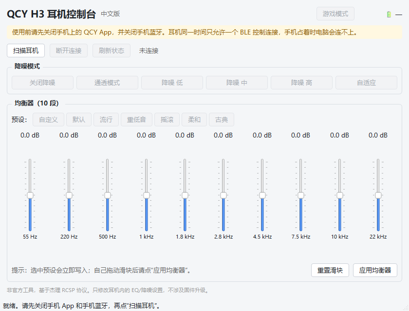

# QCY H3 耳机控制台（中文版）

在 Windows 电脑上通过蓝牙 BLE 直接控制 **QCY H3 / H3 Pro** 耳机，不需要手机 App。
界面、提示、预设名称全部为中文。

> 本项目是社区逆向杰理（JieLi）RCSP 协议后实现的非官方工具，与 QCY 官方无关。
> 只读写耳机内的 EQ、降噪、游戏模式等设置，**不涉及固件升级**，不会刷坏耳机。



> 下载：[GitHub Releases](https://github.com/zhang-jh-1/qcy-h3-controller-zh/releases/latest)
> · 源码：[github.com/zhang-jh-1/qcy-h3-controller-zh](https://github.com/zhang-jh-1/qcy-h3-controller-zh)

---

## 一、直接运行（推荐）

发布包是**文件夹版**（不是单文件 exe），解压后整个文件夹都要保留，不要只把 exe 拖出来：

1. 从 [Releases](https://github.com/zhang-jh-1/qcy-h3-controller-zh/releases/latest) 下载并解压 `QCY_H3_中文版.zip`，得到 `QCY_H3_中文版` 文件夹。
2. 耳机开机，正常连接电脑的蓝牙音频。
3. **关闭手机上的 QCY App，并关闭手机蓝牙**（耳机同一时间只允许一个 BLE 控制连接）。
4. 双击文件夹里的 `QCY_H3_中文版.exe`。
5. 点 **“扫描耳机”**，等约 5 秒，在列表里选中名称含 `QCY H3` 的设备，点 **“连接”**。
6. 连接成功后即可调整降噪模式、游戏模式和 10 段均衡器。

Windows 可能提示“未知发布者”，这是未签名开源程序的正常现象：
点 **更多信息 → 仍要运行**。

> 为什么用文件夹版：单文件 exe 每次启动都要解压到系统临时目录，
> 在部分系统/杀软环境下会启动失败；文件夹版启动更快、更稳。

---

## 二、从源码运行

### 环境要求

- Windows 10 / 11，蓝牙适配器支持 BLE（蓝牙 4.0 及以上）
- Python 3.10 及以上（推荐 3.11 / 3.12）

### 安装

在项目文件夹中打开 PowerShell：

```powershell
py -3 -m venv .venv
.\.venv\Scripts\Activate.ps1
python -m pip install -r requirements.txt
python app.py
```

如果提示“禁止运行脚本”，先执行：

```powershell
Set-ExecutionPolicy -Scope Process Bypass
```

也可以直接双击 **`安装依赖.bat`**，安装完再双击 **`启动.bat`**。

### 打包成 exe

双击 **`打包exe.bat`**，生成结果在：

```text
dist\QCY_H3_中文版\QCY_H3_中文版.exe
```

整个 `dist\QCY_H3_中文版` 文件夹就是发布包，压缩后发给别人即可。
如果确实需要单文件 exe，把 `打包exe.bat` 里的 `--onedir` 改成 `--onefile` 再打包，
但单文件版在部分系统上可能启动较慢或被杀软误报。

---

## 三、界面说明

| 区域 | 功能 |
|---|---|
| 扫描耳机 | 搜索附近的 BLE 设备，QCY 设备会加粗并排在最前 |
| 断开连接 / 刷新状态 | 断开耳机 / 重新读取电量、降噪模式、EQ、游戏模式 |
| 降噪模式 | 关闭降噪、通透模式、降噪低/中/高、自适应 |
| 预设 | 自定义、默认、流行、重低音、摇滚、柔和、古典；点预设会立即写入耳机 |
| 10 段滑块 | 55 Hz / 220 Hz / 500 Hz / 1 kHz / 1.8 kHz / 2.8 kHz / 4.5 kHz / 7.5 kHz / 10 kHz / 22 kHz |
| 重置滑块 | 把 10 段全部归零（不会自动写入，需再点“应用均衡器”） |
| 应用均衡器 | 把当前滑块曲线写入耳机 |
| 游戏模式 | 低延迟模式开关 |

滑块范围是 **-12.0 dB 到 +12.0 dB**，每格 0.5 dB。
手动拖动滑块后会自动切换到“自定义”，调好后点“应用均衡器”才会写入。

---

## 四、使用注意

1. **手机 App 会抢占连接**：使用前关闭手机 QCY App 和手机蓝牙；如果扫描不到耳机，把耳机重启一次再试。
2. **耳机同时只接受一个 BLE 控制连接**：电脑连着时手机 App 连不上，反之亦然。
3. **设置保存在耳机里**：写入成功后，手机、平板、电脑都会生效，重启耳机也保留。
4. **想恢复默认**：点“默认”预设，或把滑块全部归零后点“应用均衡器”。
5. **不要频繁快速点击**：每次写入都需要耳机确认，连续点击可能超时；等状态栏提示“已写入”再操作。
6. **固件差异**：个别固件版本可能拒绝某些命令。如果一直超时，先点“默认”再写入一次；仍然失败就换用手机 App。

---

## 五、常见问题

**Q：扫描列表里没有 QCY H3？**
- 确认耳机已开机且电量充足；
- 关闭手机 QCY App 和手机蓝牙；
- 把耳机重启，或放得离电脑近一些；
- 确认电脑蓝牙适配器支持 BLE（纯经典蓝牙的旧适配器不行）。

**Q：提示“连接失败”？**
- 手机还占着 BLE，先在手机蓝牙设置里断开 H3；
- 耳机可能已连到别的设备，长按电源键重启；
- 关掉其他蓝牙软件（如厂商控制中心）再试。

**Q：提示“耳机没有响应”？**
- 命令超时，通常是连接被抢占或固件不支持；
- 断开后重新连接，再点一次；
- 先应用“默认”预设，确认基础写入是否正常。

**Q：改完 EQ 手机 App 看不到？**
- 手机 App 需要重新连接才会刷新；
- 以耳机实际听感为准，设置已经写进耳机。

**Q：会不会把耳机刷坏？**
- 本工具只发送 EQ/降噪/游戏模式的参数命令，不包含任何固件写入或 OTA 命令，风险很低；
- 但任何第三方工具都不提供担保，请自行承担风险。

---

## 六、技术原理（简要）

QCY H3 使用杰理（JieLi）芯片的私有 **RCSP** 协议，通过 BLE GATT 控制：

| 项目 | 值 |
|---|---|
| 服务 UUID | `0000a002-0000-1000-8000-00805f9b34fb` |
| 写入特征 | `00000001-0000-1000-8000-00805f9b34fb` |
| 通知特征 | `00000002-0000-1000-8000-00805f9b34fb` |
| 包格式 | `FE DC BA` + flag + opCode + 长度(2B 大端) + sn + 参数 + `EF` |
| 连接握手 | opCode `0x0B`，参数 `00 00` |
| EQ 读取 | opCode `0xFF`，参数 `FE 01 22` |
| EQ 写入 | opCode `0xFF`，参数 `22 49 <预设> 70 FE` + 10×7 字节 |
| 每段格式 | 频率(2B 小端) + 增益(2B 小端，单位 0.01 dB) + 参考增益(2B) + Q(1B) |
| 降噪 | opCode `0xFF`，参数 `17 03 <子模式> <分组> <等级>` |
| 游戏模式 | opCode `0xC0`，参数 `02 05 <02 开 / 01 关>` |
| 电量 | opCode `0xC1`，掩码 `0x00000001`，TLV 返回 |

预设 ID：`00` 自定义、`01` 默认、`02` 流行、`03` 重低音、`04` 摇滚、`05` 柔和、`06` 古典。

---

## 七、开发与测试

仓库里的 `tests/` 目录包含不需要耳机的测试：

```powershell
# 协议层测试：包编解码、10 段 EQ 写入格式、预设、ANC、TLV
python tests\unit_test.py

# 界面逻辑测试：预设联动、自定义切换、扫描列表排序
python tests\ui_logic_test.py

# BLE 扫描线程测试（需要电脑蓝牙可用）
python tests\worker_test.py
```

没有 H3 耳机也能跑前两个；`render_test.py` / `smoke_test.py` 用于生成界面截图。

---

## 八、致谢

- 原项目：[GMarzochi/QCY_H3_WindowsEdition](https://github.com/GMarzochi/QCY_H3_WindowsEdition)（MIT）
- 协议参考：[lucianothesilva/qcy-menubar](https://github.com/lucianothesilva/qcy-menubar)、[hui1601/Quicky](https://github.com/hui1601/Quicky)、[GiorgioRafael/OpenQCY-Desktop](https://github.com/GiorgioRafael/OpenQCY-Desktop)

## 九、许可

MIT License，见 `LICENSE`。
